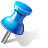

#   Mis anotaciones

**Mis anotaciones** es la bandeja personal de avisos: reúne, en una sola pantalla, todas las anotaciones de las que eres propietario o que se te han distribuido, sea cual sea el registro o la pantalla de la aplicación a la que pertenezcan. A diferencia de la ventana de [Anotaciones](RelDocumWindow.html), que muestra las anotaciones de un único registro, esta ventana es transversal a toda la aplicación y es de **solo consulta**: no permite crear ni eliminar anotaciones.

---

<aside class="doc-sidebar">
  
En esta página

  <ul>
    <li><a href="#cómo-se-abre">Cómo se abre</a></li>
    <li><a href="#el-árbol-de-anotaciones">El árbol de anotaciones</a></li>
    <li><a href="#la-rejilla-de-anotaciones">La rejilla de anotaciones</a></li>
    <li><a href="#avisos-y-el-umbral-de-aviso-próximo">Avisos y el umbral de aviso próximo</a></li>
    <li><a href="#ir-al-registro-de-origen">Ir al registro de origen</a></li>
    <li><a href="#documentos-vinculados">Documentos vinculados</a></li>
    <li><a href="#tareas-de-microsoft-to-do">Tareas de Microsoft To Do</a></li>
    <li><a href="#lista-de-distribución">Lista de distribución</a></li>
    <li><a href="#qué-no-se-puede-hacer-desde-aquí">Qué no se puede hacer desde aquí</a></li>
    <li><a href="#avisos-habituales">Avisos habituales</a></li>
  </ul>
  
Relacionado

  <ul>
    <li><a href="RelDocumWindow.html">Anotaciones</a></li>
    <li><a href="../../Modulos.html">Módulos</a></li>
    <li><a href="../../UsoGeneral.html">Uso general</a></li>
  </ul>
</aside>

## Cómo se abre

Hay dos formas de llegar a **Mis anotaciones**:

- Desde el **menú de aplicación** (el botón redondo de la esquina superior izquierda de la ventana principal), opción  **Mis Anotaciones**.
- Desde el **aviso emergente** que la aplicación muestra automáticamente cuando detecta anotaciones con avisos pendientes (al arrancar, o al abrir un registro que tenga anotaciones con aviso). El aviso emergente incluye un botón **Ver** que abre la ventana ya filtrada por ese aviso concreto.

> El aviso emergente puede mostrar uno de estos textos, según la urgencia: *"Tienes anotaciones con avisos vencidos."*, *"Tienes anotaciones con avisos próximos a vencer."* o *"Tienes anotaciones con avisos pendientes."*

---

## El árbol de anotaciones

En el panel izquierdo, un árbol titulado **"Mis anotaciones"** agrupa todas tus anotaciones en tres niveles:

1. **Tabla origen** — la pantalla o entidad a la que pertenece la anotación (contrato, escritura, seguro, etc.).
2. **Tipo de anotación**.
3. **Estado del aviso** — uno de: *Aviso no configurado*, *Aviso próximo*, *No vencido* o *Vencido*.

Pulsa sobre cualquier nodo del árbol para filtrar la rejilla y mostrar solo las anotaciones que cuelgan de ese nodo. Las anotaciones sin tabla origen o sin tipo asignado se agrupan bajo los nodos **"\<Sin origen\>"** / **"\<Sin tipo\>"**.

> Si el árbol está actualizándose y se intenta navegar por él, la aplicación avisa: *"Se está actualizando el árbol, espera a que termine."*

---

## La rejilla de anotaciones

| Columna | Descripción |
| --- | --- |
| *(icono de aviso)* | Estado del aviso de la fila, con el mismo código de color que en [Anotaciones](RelDocumWindow.html#avisos-y-vencimientos). |
| **Origen** | Pantalla o entidad de la que procede la anotación. |
| **Tipo anotación** | Clasificación de la anotación. Editable. |
| **Fecha** | Fecha de la anotación. Editable. |
| **Comentario** | Texto libre de la anotación. Editable. |
| **Documento** | Documentos vinculados a la anotación (ver [Documentos vinculados](#documentos-vinculados)). |
| **Activar aviso** | Casilla que activa **tu** recordatorio personal sobre la anotación. |
| **Fecha aviso** | Fecha de **tu** aviso. |
| **Tarea ToDo** | Tarea de Microsoft To Do vinculada (ver [Tareas de Microsoft To Do](#tareas-de-microsoft-to-do)). |
| **Propietario** | Usuario que creó la anotación. Solo lectura. |
| **Lista distribución** | Usuarios y grupos a los que se distribuye la anotación. |

> Las columnas **Activar aviso** y **Fecha aviso** de esta ventana reflejan **tu propio aviso** como destinatario de la anotación, que puede ser distinto del aviso configurado por el propietario en la ventana de [Anotaciones](RelDocumWindow.html).

Encima de la rejilla dispones del control de [búsqueda incremental](../../UsoGeneral.html#búsqueda-de-valores-en-campos) para localizar anotaciones por texto.

---

## Avisos y el umbral de aviso próximo

El campo **Días aviso próximo**, situado encima de la rejilla, determina a partir de cuántos días de antelación una anotación con aviso pasa a considerarse *próxima a vencer* (icono naranja) en lugar de *no vencida* (icono verde). Al modificar este valor, se recalculan tanto la rejilla como el árbol de anotaciones.

---

## Ir al registro de origen

Pulsa el icono de aviso de una fila para **ir directamente al registro de origen** de la anotación: la aplicación abre la pantalla correspondiente (contrato, escritura, seguro, referencia, etc.) con ese registro activo.

> Si el registro de origen ya no existe (por ejemplo, se eliminó después de crear la anotación), la aplicación te lo indica y no abre ninguna pantalla.

---

## Documentos vinculados

La columna **Documento** permite consultar y abrir los archivos vinculados a la anotación, y quitar la vinculación a alguno de ellos. Consulta [Vincular documentos](RelDocumWindow.html#vincular-documentos) para el detalle de cómo se visualizan y se abren.

> Desde **Mis anotaciones** no se pueden vincular nuevos documentos a la anotación; para ello debes abrir la ventana de [Anotaciones](RelDocumWindow.html) desde la pantalla de origen del registro.

---

## Tareas de Microsoft To Do

Igual que en la ventana de [Anotaciones](RelDocumWindow.html#tareas-de-microsoft-to-do), puedes crear, abrir o desvincular la tarea de Microsoft To Do asociada a cada anotación desde la columna **Tarea ToDo**.

---

## Lista de distribución

El botón  **Lista distribución** de cada fila abre el mismo listado de usuarios y grupos descrito en [Lista de distribución](RelDocumWindow.html#lista-de-distribución) de la ventana de Anotaciones.

---

## Qué no se puede hacer desde aquí

**Mis anotaciones** es una ventana de consulta. A diferencia de la ventana de Anotaciones de un registro, aquí no están disponibles:

- Crear nuevas anotaciones.
- Eliminar anotaciones.
- Vincular nuevos documentos.
- Abrir la ventana en modo de selección (**Seleccionar**).

Solo dispones de  **Actualizar** y los botones de edición de fila/lista habituales para los campos que sí son editables (comentario, fecha, tipo, tu propio aviso).

---

## Avisos habituales

| Aviso | Causa |
| --- | --- |
| *"Se está actualizando el árbol, espera a que termine."* | Se intentó navegar por el árbol de anotaciones mientras se estaba recargando. |
| *"Tienes anotaciones con avisos vencidos."* | Aviso emergente al detectar anotaciones cuyo aviso ya venció. |
| *"Tienes anotaciones con avisos próximos a vencer."* | Aviso emergente al detectar anotaciones cuyo aviso está próximo (según el umbral configurado). |
| *"Tienes anotaciones con avisos pendientes."* | Aviso emergente al detectar anotaciones con aviso activo, sin urgencia inmediata. |

Para los mensajes relativos a documentos vinculados y tareas de Microsoft To Do, consulta los [avisos habituales de Anotaciones](RelDocumWindow.html#avisos-habituales).

---

[Arriba](#top)
