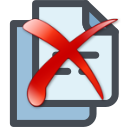

#   Anotaciones

La ventana de **Anotaciones** es un cuaderno de notas y avisos que se puede abrir desde prácticamente cualquier ficha de GTA (empresas, entidades inmobiliarias, escrituras, seguros, referencias, contratos, partes de horas, recursos, solicitudes de servicio, etc.). Permite registrar comentarios, fijar recordatorios con fecha de aviso, y —opcionalmente— vincular uno o varios documentos a cada anotación.

---

<aside class="doc-sidebar">
  
En esta página

  <ul>
    <li><a href="#cómo-se-abre">Cómo se abre</a></li>
    <li><a href="#ver-anotaciones">Ver anotaciones</a></li>
    <li><a href="#la-rejilla-de-anotaciones">La rejilla de anotaciones</a></li>
    <li><a href="#añadir-una-anotación">Añadir una anotación</a></li>
    <li><a href="#avisos-y-vencimientos">Avisos y vencimientos</a></li>
    <li><a href="#privacidad">Privacidad</a></li>
    <li><a href="#vincular-documentos">Vincular documentos</a></li>
    <li class="sub"><a href="#ver-o-abrir-un-documento-vinculado">Ver o abrir un documento</a></li>
    <li class="sub"><a href="#lista-de-archivos-vinculados">Lista de archivos vinculados</a></li>
    <li class="sub"><a href="#eliminar-un-vínculo">Eliminar un vínculo</a></li>
    <li><a href="#lista-de-distribución">Lista de distribución</a></li>
    <li><a href="#tareas-de-microsoft-to-do">Tareas de Microsoft To Do</a></li>
    <li><a href="#eliminar-una-anotación">Eliminar una anotación</a></li>
    <li><a href="#avisos-habituales">Avisos habituales</a></li>
    <li><a href="#funciones-en-desarrollo">Funciones en desarrollo</a></li>
  </ul>
  
Relacionado

  <ul>
    <li><a href="RelDocumUsuarioWindow.html">Mis anotaciones</a></li>
    <li><a href="../../Modulos.html">Módulos</a></li>
    <li><a href="../../UsoGeneral.html">Uso general</a></li>
  </ul>
</aside>

## Cómo se abre

Desde cualquier ficha que disponga de anotaciones, pulsa el botón  **Anotaciones** del grupo *Gestión datos* de la cinta de opciones (ver [Uso general](../../UsoGeneral.html)). Se abrirá la ventana de anotaciones correspondiente al registro que tengas activo en ese momento.

> El botón puede aparecer deshabilitado si la pantalla de origen no tiene definida una relación de anotaciones, o el usuario no tiene permiso de visualización.

---

## Ver anotaciones

En la parte superior de la ventana puedes filtrar qué anotaciones se muestran:

| Opción | Descripción |
| --- | --- |
| **Ver todas** | Muestra todas las anotaciones del registro, sean o no privadas de otro usuario que tengas permiso para ver. |
| **Ver mías** | Muestra únicamente las anotaciones cuyo propietario eres tú. |

> Una anotación marcada como **Privada** solo la puede ver su propietario, independientemente de la opción seleccionada.

---

## La rejilla de anotaciones

Cada fila es una anotación. Las columnas disponibles son:

| Columna | Descripción |
| --- | --- |
| *(icono de aviso)* | Indica el estado del aviso de la anotación (ver [Avisos y vencimientos](#avisos-y-vencimientos)). |
| **Tipo anotación** | Clasificación de la anotación (código y descripción). *Obligatorio.* |
| **Fecha** | Fecha de la anotación. |
| **Comentario** | Texto libre de la anotación. |
| **Documento** | Muestra los documentos vinculados a la anotación y permite añadir o quitar vínculos (ver [Vincular documentos](#vincular-documentos)). |
| **Activar aviso** | Casilla que activa el recordatorio de la anotación. |
| **Fecha aviso** | Fecha en la que debe saltar el aviso. *Obligatoria si se activa el aviso.* |
| **Propietario** | Usuario que creó la anotación. Solo lectura. |
| **Privado** | Casilla que restringe la visibilidad de la anotación a su propietario. |
| **Lista distribución** | Abre el listado de usuarios y grupos a los que se distribuye la anotación (ver [Lista de distribución](#lista-de-distribución)). |
| **Tarea ToDo** | Permite crear, abrir o desvincular una tarea de Microsoft To Do asociada a la anotación (ver [Tareas de Microsoft To Do](#tareas-de-microsoft-to-do)). |

---

## Añadir una anotación

1. Pulsa el botón  **Nueva fila** / **Nuevo** de la cinta de opciones.
2. Se añade una fila con la fecha de hoy y tú como propietario.
3. Indica el **Tipo anotación** y escribe el **Comentario**.
4. Si lo necesitas, activa el aviso o vincula documentos (ver secciones siguientes).

> Mientras haya una fila en edición no se pueden vincular documentos ni cambiar de anotación. Si lo intentas, aparecerá el aviso *"Termina antes la edición en curso."*

---

## Avisos y vencimientos

Al activar **Activar aviso** e indicar una **Fecha aviso**, la anotación funciona como recordatorio. El icono situado al principio de la fila indica su estado:

| Estado | Significado |
| --- | --- |
| Sin icono de color | La anotación no tiene aviso activado. |
|  Verde | El aviso está activo y su fecha todavía queda lejos. |
|  Naranja | El aviso está próximo a vencer (dentro de los siguientes días, según configuración). |
|  Rojo | El aviso está vencido: la fecha de aviso ya ha pasado. |

---

## Privacidad

Marcar la casilla **Privado** en una anotación hace que solo su propietario pueda verla, aunque otros usuarios tengan acceso a la ventana de anotaciones de ese registro. Las anotaciones no privadas son visibles para cualquier usuario con permiso sobre la pantalla de origen.

---

## Vincular documentos

En la columna **Documento** de cada anotación puedes vincular uno o varios archivos. Pulsa sobre el control de la columna (muestra el nombre del archivo, o el número de archivos vinculados, o el texto **Vínculos** si no hay ninguno todavía) para abrir el selector correspondiente:

-  **Vincular documentos** — abre el selector de archivos estándar de Windows, con selección múltiple. Los tipos de archivo admitidos son: *Todos los archivos*, *Acrobat PDF (\*.pdf)*, *Microsoft Word (\*.doc\*)*, *Microsoft Excel (\*.xl\*)*, *Microsoft Access 2007 (\*.accdb)*, *Imágenes (jpg, png, tif, bmp, gif)*, *Archivos de texto (\*.txt)* y *Archivos de texto (\*.csv)*.
-  **Vincular SharePoint** — si el perfil documental de la pantalla de origen está configurado para SharePoint, en lugar del selector de Windows se abre el explorador de documentos de Microsoft 365 para elegir los archivos.

> Solo se pueden vincular documentos desde la ventana de anotaciones abierta desde su pantalla de origen (no desde otros modos de la ventana), y es necesario haber indicado antes el **Tipo anotación** de la fila. Si falta el tipo, el sistema lo indica con el aviso *"No es posible vincular documentos, es necesario definir el tipo de anotación."* y abre automáticamente la celda para completarlo.
>
> Si la pantalla de origen no tiene definido un perfil documental, aparece el aviso *"No es posible vincular documentos, es necesario definir antes el perfil documental."* y no se puede continuar.

### Ver o abrir un documento vinculado

- Si la anotación tiene un único documento vinculado, al pulsar sobre el control de la columna **Documento** se abre directamente con la aplicación asociada al tipo de archivo (Word, PDF, Excel, etc.).
- Si tiene varios documentos vinculados, se abre la ventana **Lista de archivos vinculados**.

### Lista de archivos vinculados

Muestra todos los documentos vinculados a la anotación, cada uno con su icono según el tipo de archivo, su nombre (pulsa para abrirlo) y su ruta o enlace de ubicación.

Desde esta ventana también puedes:

-  **Nuevo** — añade más archivos a la anotación (local o desde SharePoint, según el perfil documental).
-  **Eliminar** — quita el vínculo a los archivos seleccionados.
- **Abrir** — abre el archivo seleccionado.

> Al añadir un único archivo local se preguntará *"El documento se vinculó correctamente.\n¿Deseas abrirlo?"*. Al añadir varios, se confirma con *"Se vincularon varios archivos."*
>
> Si intentas vincular un archivo que ya estaba en la lista, la aplicación lo omite y te avisa: *"El archivo {nombre} ya se encontraba en la lista."* (o el equivalente para varios archivos).
>
> No se admiten archivos ubicados en una carpeta distinta a la ya utilizada por los documentos existentes de la anotación.

### Eliminar un vínculo

Para quitar la vinculación a uno o varios documentos, selecciónalos y pulsa  **Eliminar vínculos**. Se pedirá confirmación:

> *"Se quitará la vinculación a archivos de la líneas seleccionadas. Los archivos no serán eliminados.\n\n¿Quitar la vinculación?"*
>
> **Importante:** esta acción solo elimina el vínculo dentro de GTA. El archivo original no se borra de su ubicación (disco o SharePoint).

---

## Lista de distribución

Cada anotación puede tener asociada una lista de usuarios y grupos a los que va dirigida. Pulsa el botón **Lista distribución** de la fila para abrir el listado:

-  **Añadir usuario** — incorpora un usuario a la lista de distribución.
-  **Añadir grupo** — incorpora un grupo de recursos a la lista de distribución.
-  **Quitar de la lista** — elimina a la persona de la lista de distribución.
-  **Cerrar** — cierra el listado.

> Solo puede haber un listado de distribución abierto a la vez; se cierra automáticamente si cambias de anotación.

---

## Tareas de Microsoft To Do

Una anotación se puede vincular a una tarea de Microsoft To Do, de forma que el seguimiento del aviso se pueda hacer también desde To Do.

- Pulsa el icono  de la columna correspondiente para crear la tarea. Se solicitará confirmación: *"Se creará una tarea ToDo vinculada a la anotación.\n\n¿Confirmas la creación de tarea ToDo?"* Si la anotación ya tiene el icono visible pero aún no se ha configurado una lista de tareas, se avisará: *"Para asociar tareas es necesario introducir una lista de tareas ToDo."*
- Una vez creada, el mismo icono abre la tarea existente en To Do.
- Pulsa el icono  (visible solo si la anotación tiene tarea asociada) para desvincularla. Esto no elimina la tarea de Microsoft To Do, solo su vínculo con la anotación.

---

## Eliminar una anotación

Selecciona la fila y pulsa  **Eliminar** en la cinta de opciones. Se solicitará confirmación antes de borrar la anotación junto con su lista de distribución y el vínculo a la tarea ToDo, si los tuviera. Los documentos y la tarea ToDo vinculados no se eliminan, solo se desvinculan.

---

## Avisos habituales

| Aviso | Causa |
| --- | --- |
| *"El tipo de anotación es obligatorio."* | Se intentó guardar una anotación sin indicar el tipo. |
| *"La fecha de la anotación no puede ser anterior a 01-01-2000."* | La fecha introducida es anterior al mínimo admitido. |
| *"La fecha de aviso es obligatoria si se activa el aviso."* | Se activó **Activar aviso** sin indicar **Fecha aviso**. |
| *"Termina antes la edición en curso."* | Se intentó vincular un documento, cambiar de fila o cerrar la ventana con una edición sin confirmar. |
| *"No es posible vincular documentos, es necesario definir antes el perfil documental."* | La pantalla de origen no tiene configurado un perfil documental. |
| *"No es posible vincular documentos, es necesario definir el tipo de anotación."* | Se intentó vincular un archivo antes de indicar el tipo de anotación de la fila. |
| *"El perfil está definido para utilizarlo en SharePoint pero falta el sitio."* | El perfil documental de la pantalla de origen apunta a SharePoint pero no tiene sitio configurado. |
| *"No se ha configurado el acceso al sitio SharePoint."* | No se puede acceder a SharePoint por falta de configuración de la conexión con Microsoft 365. |
| *"Usuario sin permisos para ver la relación de archivos vinculados."* | El usuario no tiene permiso para abrir la lista de archivos vinculados. |
| *"No se pudo abrir el documento. Acceso denegado o no existe."* | El archivo vinculado no se pudo abrir: ya no existe en su ubicación o no hay acceso a ella. |
| *"El usuario no tiene permisos para utilizar el explorador 365."* | El usuario no tiene permiso para usar el selector de archivos de SharePoint. |

---

## Funciones en desarrollo

Algunos elementos de la ventana están presentes pero todavía no operativos:

- El botón **Ir a origen** de la cinta de opciones (pensado para navegar directamente al registro de origen de la anotación) no realiza ninguna acción por el momento. Esta función sí está disponible desde [Mis anotaciones](RelDocumUsuarioWindow.html#ir-al-registro-de-origen).
- La opción **Ver lista distribución** de la sección [Ver anotaciones](#ver-anotaciones) y el botón **Lista distribución** de la cinta de opciones se encuentran ocultos/desactivados.

---

[Arriba](#top)
