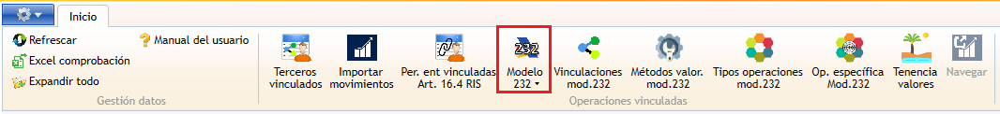
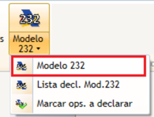
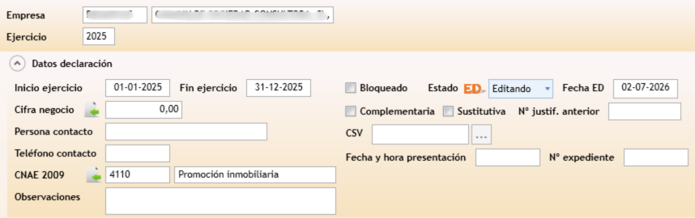

#   Ficha de declaración del Modelo 232

La **ficha del Modelo 232** es la declaración completa de una empresa y ejercicio: cifra de negocio, las líneas de operaciones con personas o entidades vinculadas, las operaciones en paraísos fiscales, las tenencias de valores, y el envío de la declaración a la AEAT.

---

<aside class="doc-sidebar">
  
En esta página

  <ul>
    <li><a href="#cómo-se-abre">Cómo se abre</a></li>
    <li><a href="#cabecera">Cabecera</a></li>
    <li><a href="#operaciones-vinculadas">Operaciones vinculadas</a></li>
    <li><a href="#operaciones-en-paraísos-fiscales">Operaciones en paraísos fiscales</a></li>
    <li><a href="#tenencia-de-valores-en-paraísos-fiscales">Tenencia de valores</a></li>
    <li><a href="#traspasar-movimientos-a-la-declaración">Traspasar movimientos</a></li>
    <li><a href="#estados-de-la-declaración">Estados de la declaración</a></li>
    <li><a href="#enviar-a-la-aeat">Enviar a la AEAT</a></li>
    <li><a href="#comprobar-la-presentación">Comprobar la presentación</a></li>
    <li><a href="#avisos-habituales">Avisos habituales</a></li>
  </ul>
  
Relacionado

  <ul>
    <li><a href="RelModelo232Window.html">Lista de declaraciones del Modelo 232</a></li>
    <li><a href="MovVinculada232Window.html">Operaciones vinculadas</a></li>
    <li><a href="RelTerceroVinculado232Window.html">Terceros vinculados</a></li>
    <li><a href="../../../Modulos.html">Módulos</a></li>
    <li><a href="../../../UsoGeneral.html">Uso general</a></li>
  </ul>
</aside>

## Cómo se abre

Puedes llegar a la ficha de tres formas:

-  Desde la ventana de [Operaciones vinculadas](MovVinculada232Window.html), botón  **Modelo 232** de la cinta de opciones — abre la ficha de declaración de la empresa y ejercicio activos.
- Desde la [lista de declaraciones](RelModelo232Window.html), haciendo doble clic en una fila o pulsando **Editar**.
- Desde la [lista de declaraciones](RelModelo232Window.html), pulsando **Nuevo** — abre la ficha en modo alta para crear una declaración nueva.

---

## Cabecera

| Campo | Descripción |
| --- | --- |
| **Inicio ejercicio** / **Fin ejercicio** | Periodo de la declaración. |
| **Cifra de negocio** | Importe de la cifra de negocio de la empresa en el ejercicio. Se puede importar automáticamente desde **Taxor** con el botón  situado junto al campo. |
| **CNAE 2009** | Código de actividad de la empresa, con su descripción. También se puede importar  desde Taxor. |
| **Persona de contacto** / **Teléfono de contacto** | Datos de contacto de la declaración. |
| **Observaciones** | Texto libre. |
| **Complementaria** / **Sustitutiva** / **Justificante anterior** | Datos de declaraciones complementarias o sustitutivas. |
| **Estado** | Estado actual de la declaración (ver [Estados de la declaración](#estados-de-la-declaración)), con la fecha en que se alcanzó cada estado. |
| **Bloqueado** | Casilla que bloquea la edición de las tres secciones de detalle. |
| **CSV** | Código Seguro de Verificación. El botón **...** situado junto al campo permite consultarlo en la sede electrónica una vez informado. |
| **Fecha y hora presentación AEAT** / **Expediente AEAT** | Datos de la presentación, una vez enviada. |
| **Descripción error AEAT** | Mensaje de error devuelto por la AEAT, si lo hubiera. Se puede quitar con el botón situado junto al campo. |

---

## Operaciones vinculadas

Detalle de las operaciones con personas o entidades vinculadas a declarar:

| Columna | Descripción |
| --- | --- |
| **Orden** | Número de línea, asignado automáticamente. |
| **NIF matriz** / **Nombre matriz** | Identificación de la sociedad matriz, si aplica. |
| **Tercero** | Tercero GTA vinculado, si procede. |
| **NIF** / **Nombre** | Identificación de la persona o entidad vinculada. |
| **Tipo persona** | Física o jurídica. |
| **No residente** | Casilla que indica si no reside en España. |
| **País** / **Provincia** | Domicilio de la persona/entidad. |
| **Vinculación** | Tipo de vinculación con la empresa. |
| **Tipo de operación** | Tipo de operación vinculada. |
| **Valoración** | Método de valoración de la operación. |
| **Ingreso/Pago** | `I` (ingreso) o `P` (pago). |
| **Importe operación** | Importe de la operación. |

El encabezado de la sección muestra el número total de operaciones. Puedes añadir, editar o eliminar líneas manualmente, o generarlas automáticamente con [Traspasar movimientos](#traspasar-movimientos-a-la-declaración).

---

## Operaciones en paraísos fiscales

| Columna | Descripción |
| --- | --- |
| **Orden** | Número de línea, asignado automáticamente. |
| **Nombre** | Nombre de la persona o entidad. |
| **Tipo persona** | Física o jurídica. |
| **País** | País o territorio considerado paraíso fiscal. |
| **Descripción** | Descripción de la operación o situación. |
| **Importe** | Importe de la operación. |

> Esta sección **no** se genera automáticamente desde ninguna otra pantalla: sus líneas se introducen siempre a mano.

---

## Tenencia de valores en paraísos fiscales

| Columna | Descripción |
| --- | --- |
| **Orden** | Número de línea, asignado automáticamente. |
| **Tenencia** | Tipo de tenencia. |
| **Clave país** | País o territorio considerado paraíso fiscal. |
| **Valor adquisición** | Valor de adquisición de la participación o valor. |
| **% Participación** | Porcentaje de participación. |

> Igual que la sección anterior, esta tabla **no** se genera automáticamente: se introduce siempre de forma manual.
>
> Mientras la declaración está **Bloqueada**, ninguna de las tres secciones de detalle admite altas, bajas ni modificaciones.

---

## Traspasar movimientos a la declaración

El botón  **Traspaso movs. ops. vinculadas** de la cinta de opciones recalcula la sección [Operaciones vinculadas](#operaciones-vinculadas) a partir de los movimientos ya clasificados en [Operaciones vinculadas](MovVinculada232Window.html) y de la matriz de [Terceros vinculados](RelTerceroVinculado232Window.html):

1. Recalcula qué movimientos tienen obligación de declararse, aplicando los mismos criterios que el botón **Marcar obligación modelo 232** (operaciones específicas, mismo tipo/valoración frente a la cifra de negocio, o total por tercero — ver [Marcar obligación de declarar](MovVinculada232Window.html#marcar-obligación-de-declarar)).
2. **Elimina todas las líneas de operaciones vinculadas ya existentes en la declaración y las regenera desde cero**, agrupando los movimientos con obligación de declarar por tercero, tipo de vinculación, tipo de operación, método de valoración e ingreso/pago.
3. Deja la declaración en estado **En edición**.

> El traspaso **no afecta** a las secciones de operaciones en paraísos fiscales ni de tenencia de valores: esas dos siempre hay que mantenerlas a mano.

Antes de traspasar, la aplicación comprueba varias condiciones y no continúa si alguna falla, indicando el motivo, por ejemplo:

- *"La declaración está bloqueada y no se puede traspasar."*
- *"No se pueden marcar operaciones a declarar si hay movimientos sin clasificar."*
- *"Existen movimientos sin NIF asociado."*
- *"Sin movimientos en el periodo."*

> **Recuerda:** Desde la [lista de declaraciones](RelModelo232Window.html#traspaso-masivo) puedes hacer este mismo traspaso sobre varias declaraciones a la vez, sin abrir cada ficha por separado.

---

## Estados de la declaración

| Estado | Significado |
| --- | --- |
|  **Sin datos** | Estado inicial: la declaración existe pero no tiene ninguna operación. |
|  **En edición** | La declaración se está completando. Se activa automáticamente al modificar cualquier dato distinto del propio estado o del bloqueo. |
|  **Preparada** | La declaración está lista para enviar. |
|  **Emitida** | Se ha generado el fichero de envío a la AEAT (ver [Enviar a la AEAT](#enviar-a-la-aeat)). |
|  **Presentado en AEAT** | La AEAT ha confirmado la recepción de la declaración (ver [Comprobar la presentación](#comprobar-la-presentación)). |
|  **No presenta** | La empresa no está obligada a presentar esta declaración. |

Al cambiar el estado a **Sin datos** o **No presenta**, la aplicación pide confirmación porque la operación **elimina todos los datos de la declaración** (operaciones vinculadas, operaciones en paraísos fiscales y tenencias):

Otras validaciones sobre el estado:

- No se puede pasar a **Presentado en AEAT** sin haber enviado antes la declaración.
- No se puede pasar a **No presenta** si la declaración ya tiene operaciones.
- No se puede pasar a los demás estados si la declaración no tiene ninguna operación.

---

## Enviar a la AEAT

Al pulsar el botón **Envío** de la cinta de opciones:

1. Se genera el fichero de presentación del Modelo 232 con los datos de la cabecera y de las tres secciones de detalle, y se guarda en el equipo.
2. La declaración pasa a estado  **Emitida**.
3. Se muestra un cuadro de diálogo para confirmar la apertura del formulario web de la AEAT para la presentación de la declaración.

> Una vez generado, **la ruta del archivo de presentación se copia en el portapapeles** para facilitar su introducción en el formulario AEAT de la web.
>
> También puedes enviar una declaración directamente desde la [lista de declaraciones](RelModelo232Window.html), _**sin necesidad de abrir su ficha**_.

---

## Comprobar la presentación

El botón  **Comprobación** consulta en la AEAT, usando el certificado digital configurado para la empresa, el estado de una declaración ya enviada:

- Si la consulta es correcta, actualiza el **CSV**, el **Expediente AEAT**, el **Justificante AEAT** y la **fecha de presentación**, borra cualquier error anterior, y la declaración pasa a estado **Presentado en AEAT**.
- Si la AEAT devuelve un error, se guarda su descripción en el campo **Descripción error AEAT** de la cabecera.

---

## Avisos habituales

| Aviso | Causa |
| --- | --- |
| *"Es obligatoria la empresa."* | Falta la empresa de la declaración. |
| *"La fecha de inicio de ejercicio debe ser posterior al final del ejercicio." / "La fecha final del ejercicio debe ser posterior a la inicial."* | Fechas de la cabecera incoherentes. |
| *"El ejercicio no puede ser superior a 12 meses." / "La duración del ejercicio no puede ser superior al año."* | El periodo de la declaración supera un año. |
| *"NIF de la matriz inválido." / "NIF de la persona o entidad inválido."* | El NIF introducido en una línea de operaciones no tiene un formato válido. |
| *"El tipo de operación es obligatorio."* | Falta el tipo de operación en una línea. |
| *"Obligatorio país"* | Falta el país en una línea de operaciones. |
| *"Obligatorio provincia si el país es España (ES)."* | Se indicó España como país sin indicar la provincia. |
| *"Obligatorio tipo de valoración." / "Obligatorio tipo de vinculación."* | Falta alguno de estos dos datos en una línea. |
| *"El importe debe ser positivo y distinto de cero."* | El importe de una línea es cero o negativo. |
| *"El valor de 'Ingreso / Pago' debe ser 'I' ó 'P'."* | Se introdujo un valor distinto en ese campo. |
| *"La declaración está bloqueada y no se puede traspasar."* | Se intentó traspasar movimientos a una declaración bloqueada. |
| *"No se pueden marcar operaciones a declarar, hay movimientos sin clasificar."* | Quedan movimientos en Operaciones vinculadas sin tipo de operación asignado. |
| *"Existen movimientos sin NIF asociado."* | Algún tercero de los movimientos no tiene asociación con Navision completa (ver [Terceros vinculados](RelTerceroVinculado232Window.html#asociación-con-navision)). |
| *"La declaración no tiene operaciones."* | Se intentó enviar la declaración, o cambiar su estado, sin que tenga ninguna línea de operaciones. |

---

[Arriba](#top)
