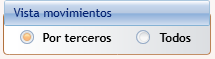
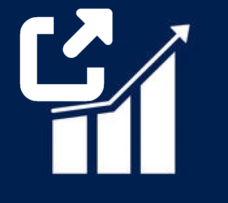
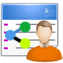

#   Operaciones vinculadas (Modelo 232)

**Operaciones vinculadas** es la pantalla donde se importan desde Navision los movimientos contables con terceros vinculados, se clasifican fiscalmente y se determina qué operaciones deben declararse en el **Modelo 232** de la Agencia Tributaria (declaración informativa de operaciones con personas o entidades vinculadas). No es una simple ficha ni una lista: combina importación, clasificación línea a línea y totalización por tercero, previas a la generación de la declaración.

---

<aside class="doc-sidebar">
  
En esta página

  <ul>
    <li><a href="#cómo-se-abre">Cómo se abre</a></li>
    <li><a href="#cabecera">Cabecera</a></li>
    <li><a href="#vistas-de-movimientos">Vistas de movimientos</a></li>
    <li class="sub"><a href="#vista-por-terceros">Vista «Por terceros»</a></li>
    <li class="sub"><a href="#vista-movimientos">Vista «Movimientos»</a></li>
    <li><a href="#importar-movimientos-de-navision">Importar movimientos de Navision</a></li>
    <li><a href="#clasificar-y-eliminar-movimientos">Clasificar y eliminar movimientos</a></li>
    <li><a href="#marcar-obligación-de-declarar">Marcar obligación de declarar</a></li>
    <li><a href="#navegar-al-documento-de-origen">Navegar al documento de origen</a></li>
    <li><a href="#exportar-a-excel">Exportar a Excel</a></li>
    <li><a href="#tablas-y-ventanas-relacionadas">Tablas y ventanas relacionadas</a></li>
    <li><a href="#avisos-habituales">Avisos habituales</a></li>
  </ul>
  
Relacionado

  <ul>
    <li><a href="RelTerceroVinculado232Window.html">Terceros vinculados</a></li>
    <li><a href="RelPerEntidVincAr164RisWindow.html">Personas/Entidades vinculadas Art. 16.4 RIS</a></li>
    <li><a href="RelModelo232Window.html">Lista de declaraciones del Modelo 232</a></li>
    <li><a href="Modelo232Window.html">Ficha de declaración del Modelo 232</a></li>
    <li><a href="../../../Modulos.html">Módulos</a></li>
    <li><a href="../../../UsoGeneral.html">Uso general</a></li>
  </ul>
</aside>

## Cómo se abre

Desde la ventana principal, ve a la pestaña **Financiero** → grupo **Informes NAVISION**, y pulsa el botón de **Operaciones vinculadas**.

> Esta es la única vía de acceso a la ventana: no se abre desde ninguna ficha de tercero, referencia o documento contable.

---

## Cabecera

En la parte superior de la ventana se fijan la empresa y el ejercicio sobre los que se está trabajando:

| Campo | Descripción |
| --- | --- |
| **Empresa** | Empresa GTA activa. Se selecciona mediante buscador. |
| **Ejercicio** | Año fiscal (entre 2000 y 2999). |
| **Cifra de negocio** | Importe de la cifra de negocio de la empresa en el ejercicio, usado como referencia para calcular la obligación de declarar (ver [Marcar obligación de declarar](#marcar-obligación-de-declarar)). Editable solo si tienes permiso de edición y la declaración no está bloqueada. |
|  *(botón junto a Cifra de negocio)* | Recupera automáticamente la cifra de negocio desde **Taxor**. |
| **Mostrar sin movimientos** | Casilla visible solo en la vista «Por terceros»: muestra también los terceros vinculados que todavía no tienen movimientos importados. |
| **Bloqueado Mov** | Casilla que bloquea la clasificación de movimientos de la declaración activa. Con la declaración bloqueada, los campos de clasificación de esta ventana pasan a ser de solo lectura. |

---

## Vistas de movimientos

Un grupo de opciones en la cabecera permite alternar entre dos formas de trabajar con los movimientos:

- **Por terceros** — agrupa los movimientos por tercero vinculado, con sus totales.
- **Movimientos** — muestra todos los movimientos individuales en una única rejilla, con un panel para clasificarlos en bloque.

La vista elegida se recuerda entre sesiones.

---

### Vista «Por terceros»

El panel principal muestra un árbol con un nodo por cada **tercero vinculado** a la empresa y ejercicio activos:

| Columna | Descripción |
| --- | --- |
| **NIF** / **Nombre** | Identificación del tercero. |
| **Cod. tercero Navision** / **Tipo tercero** | Código y tipo (cliente/proveedor) en Navision. |
| **Total operaciones** | Importe total de operaciones del tercero en el ejercicio. |
|  | Importa desde Navision los movimientos de ese tercero concreto (ver [Importar movimientos de Navision](#importar-movimientos-de-navision)). |
| **Total sin clasificar** | Importe de operaciones del tercero que todavía no tienen tipo de operación asignado. Se resalta en color cuando es mayor que cero. |
| **Vinculación** | Tipo de vinculación con la empresa (socio, administrador, grupo, etc.). |
| **Fecha inicio** / **Fecha fin** | Periodo de vigencia de la vinculación. Si no tiene fecha fin, se muestra **"indefinido"**. |

Al expandir un tercero se muestran sus movimientos **agrupados por tipo de operación**, con los campos que definen la clasificación fiscal del grupo:

| Campo | Descripción |
| --- | --- |
| **Ingreso/Pago** | `I` (ingreso) o `P` (pago). Solo admite estos dos valores. |
| **Obligación** | Indica si el grupo de operaciones está marcado para declarar en el Modelo 232. Informativo, no editable directamente aquí (ver [Marcar obligación de declarar](#marcar-obligación-de-declarar)). |
| **Excluir declaración** | Casilla editable: excluye el grupo de la declaración aunque tenga obligación marcada. |
| **Tipo de operación** | Clasificación de la operación según el Modelo 232. *Obligatorio.* Se selecciona mediante buscador. |
| **Método de valoración** | Método de valoración de la operación según el Modelo 232. *Obligatorio.* Se selecciona mediante buscador. |
| **Operación específica** | Código de operación específica del Modelo 232, si aplica. |
| **Importe** | Importe total del grupo. |

Cada grupo tiene dos botones:  para confirmar la clasificación introducida, y  para eliminar los movimientos del grupo.

Al expandir el grupo se muestra, en modo solo lectura, el detalle de los movimientos individuales que lo componen: fecha, tipo y número de documento, número de factura, cuenta contable, tercero, base e importe declarable, entre otros.

---

### Vista «Movimientos»

Muestra en una rejilla **todos los movimientos individuales** de la empresa y ejercicio activos, con las mismas columnas descritas en el detalle de la vista anterior, editables si tienes permiso y la declaración no está bloqueada.

Encima de la rejilla hay un panel para **clasificar varios movimientos a la vez**: selecciona las filas en la rejilla, indica en el panel el **Ingreso/Pago**, **Excluir declaración**, **Tipo de operación**, **Método de valoración** y **Operación específica** que quieras aplicar, y pulsa uno de estos botones:

| Botón | Descripción |
| --- | --- |
|  **Clasificar** | Aplica los valores del panel a todos los movimientos seleccionados en la rejilla. |
|  **Eliminar** | Elimina los movimientos seleccionados. |
|  **Añadir** | Añade una nueva línea copiando los datos de la fila seleccionada, excepto el importe. Útil para desglosar manualmente un movimiento en varios. |

> No es posible añadir movimientos en esta pantalla, solo desglosar uno ya existente. Para incluir nuevos movimientos, se deben añadir primero en contabilidad.

---

## Importar movimientos de Navision

El botón **Importar movimientos Navision** de la cinta de opciones importa desde Navision los movimientos contables de los terceros que se están mostrando en pantalla (facturas, abonos, cobros y pagos).

1. Cambia a la vista **Por terceros** (la importación no está disponible desde la vista Movimientos).
2. Asegúrate de que se muestran en pantalla los terceros que quieres importar (activa **Mostrar sin movimientos** si es necesario).
3. Pulsa **Importar movimientos Navision** en la cinta, o el botón  de la fila de un tercero concreto para importar solo los suyos.

> Si un tercero ya tiene movimientos importados, no se vuelven a importar: primero hay que eliminarlos por completo desde la ventana.
>
> Si intentas importar desde la vista Movimientos, la aplicación avisa que la vista debe ser «Por terceros».
>
> Si no se muestra ningún tercero en pantalla, la aplicación avisa que solo se importan movimientos de los terceros visibles.

---

## Clasificar y eliminar movimientos

- **Clasificar**: aplica el tipo de operación, método de valoración, operación específica, ingreso/pago y exclusión de declaración a los movimientos seleccionados (ver botones en cada vista).
- **Eliminar**: quita definitivamente los movimientos seleccionados. Se solicita confirmación antes de proceder, y la aplicación indica cuántos movimientos se van a eliminar.

---

## Marcar obligación de declarar

El botón **Modelo 232** de la cinta de opciones incluye la opción **Marcar obligación modelo 232**, que recalcula automáticamente qué operaciones deben declararse, aplicando los criterios de la normativa del Modelo 232:

1. **Operaciones específicas**: si la suma de las operaciones con una misma **operación específica** supera el límite configurado (por defecto, 100.000 €), se marcan todas como declarables.
2. **Mismo tipo de operación y valoración**: si la suma de operaciones del mismo tipo y método de valoración supera un porcentaje de la **cifra de negocio** (por defecto, el 50 %), se marcan como declarables.
3. **Por tercero**: si el total de operaciones con un mismo tercero (por NIF) supera el límite configurado (por defecto, 250.000 €), se marcan todas las operaciones de ese tercero como declarables.

> Este cálculo actualiza la columna **Obligación**, pero no elimina las marcas de **Excluir declaración** que hayas establecido manualmente.

Desde el mismo botón desplegable se accede también a la [ficha del Modelo 232](Modelo232Window.html) (donde se genera la declaración final a partir de los movimientos ya clasificados aquí) y a la [lista de declaraciones](RelModelo232Window.html) del Modelo 232.

---

## Navegar al documento de origen

Disponible solo en la vista **Movimientos**: selecciona un movimiento y pulsa **Navegar** en la cinta de opciones para abrir en Navision el documento contable del que procede (factura, abono, cobro o pago).

> Si el documento ya no se puede localizar en Navision, la aplicación te lo indica y no abre ninguna pantalla.

---

## Excel de comprobación

El botón **Exportar a Excel** de la cinta genera un libro de comprobación con el detalle de operaciones vinculadas por tercero, vinculación, valoración, tipo de operación e ingreso/pago, incluyendo una columna de **comprobación** que cruza los importes declarados como ingreso con los declarados como pago para el mismo tercero y clasificación, de forma que se puedan detectar descuadres antes de generar la declaración.

---

## Tablas y ventanas relacionadas

Desde la cinta de opciones de esta ventana se puede acceder directamente a las tablas maestras usadas para clasificar los movimientos, y a otras gestiones relacionadas con la fiscalidad de operaciones vinculadas:

| Botón | Descripción |
| --- | --- |
|  [**Terceros vinculados**](RelTerceroVinculado232Window.html) | Abre el mantenimiento de terceros vinculados a la empresa (vinculación, periodo de vigencia). |
|  [**Personas / Entidades vinculadas Art. 16.4 RIS**](RelPerEntidVincAr164RisWindow.html) | Abre la gestión del modelo informativo FOV de personas y entidades vinculadas del artículo 16.4 del RIS, un modelo distinto del 232 relacionado con las mismas relaciones de vinculación. |
|  **Tipos de vinculación** | Mantenimiento de los tipos de vinculación disponibles para clasificar terceros. |
|  **Métodos de valoración** | Mantenimiento de los métodos de valoración del Modelo 232. |
|  **Tipos de operación** | Mantenimiento de los tipos de operación del Modelo 232. |
|  **Operaciones específicas** | Mantenimiento de los códigos de operación específica del Modelo 232. |
|  **Tenencias** | Mantenimiento de los tipos de tenencia relacionados con el Modelo 232. |

---

## Avisos habituales

| Aviso | Causa |
| --- | --- |
| *"Ingreso/Pago solo admite los valores 'I'/'P'"* | Se introdujo un valor distinto de I o P en el campo Ingreso/Pago. |
| *"El tipo de operación es obligatorio"* | Se intentó clasificar un grupo o movimiento sin indicar el tipo de operación. |
| *"El método de valoración es obligatorio"* | Falta el método de valoración al clasificar (ver nota en la vista «Por terceros» sobre cuándo se dispara realmente este aviso). |
| *"No hay movimientos seleccionados para eliminar."* | Se pulsó Eliminar sin seleccionar ninguna fila. |
| *"Se eliminará el movimiento seleccionado." / "Se eliminarán los N movimientos seleccionados."* seguido de *"¿Confirmas la eliminación?"* | Confirmación previa a eliminar movimientos. |
| *"No se han seleccionado movimientos"* | Se pulsó Clasificar sin seleccionar ninguna fila. |
| *"No se modificaron movimientos. Posiblemente ya tenían la clasificación seleccionada"* | La clasificación aplicada coincidía con la que ya tenían los movimientos seleccionados. |
| *"El tercero {código}-{nombre} ya tiene movimientos. No se importaron datos"* | Se intentó importar movimientos de un tercero que ya los tenía. Hay que eliminarlos antes de reimportar. |
| *"Para realizar la importación de movimientos, la vista debe ser 'Por terceros'"* | Se intentó importar movimientos estando en la vista Movimientos. |
| *"No se muestran terceros. Solo se importan movimientos de los terceros que se muestran en pantalla."* | Se intentó importar sin que hubiera terceros visibles en el árbol. |
| *"Selecciona primero un movimiento para navegar al documento NAVISION."* | Se pulsó Navegar sin seleccionar ningún movimiento. |
| *"No se ha podido determinar el documento NAVISION"* | El documento de origen del movimiento no se pudo localizar en Navision. |

---

[Arriba](#top)
