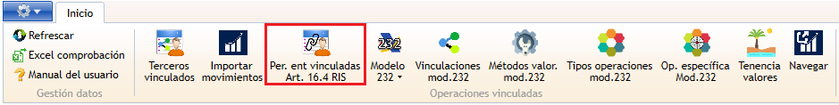
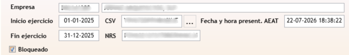
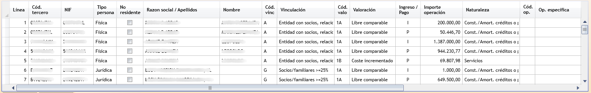

#   Personas y entidades vinculadas (Art. 16.4 RIS)

**Personas y entidades vinculadas (Art. 16.4 RIS)** es la ventana donde se prepara y presenta el **formulario FOV** de la Agencia Tributaria: la documentación específica de operaciones con personas o entidades vinculadas que deben incluirse en el Impuesto sobre Sociedades según el artículo 16.4 del RIS. Es un modelo **distinto del Modelo 232**, aunque parte de los mismos datos de vinculación y de los mismos movimientos importados en [Operaciones vinculadas](MovVinculada232Window.html).

---

<aside class="doc-sidebar">
  
En esta página

  <ul>
    <li><a href="#cómo-se-abre">Cómo se abre</a></li>
    <li><a href="#cabecera-de-la-declaración">Cabecera de la declaración</a></li>
    <li><a href="#Generar-resumen-desde-Operaciones-vinculadas">Generar resumen</a></li>
    <li><a href="#la-rejilla-de-personas-y-entidades-vinculadas">La rejilla de personas y entidades vinculadas</a></li>
    <li><a href="#añadir-o-editar-una-línea-manualmente">Añadir o editar una línea</a></li>
    <li><a href="#enviar-a-la-aeat">Enviar a la AEAT</a></li>
    <li><a href="#bloqueo-de-la-declaración">Bloqueo de la declaración</a></li>
    <li><a href="#avisos-habituales">Avisos habituales</a></li>
  </ul>
  
Relacionado

  <ul>
    <li><a href="MovVinculada232Window.html">Operaciones vinculadas</a></li>
    <li><a href="RelTerceroVinculado232Window.html">Terceros vinculados</a></li>
    <li><a href="RelModelo232Window.html">Lista de declaraciones del Modelo 232</a></li>
    <li><a href="Modelo232Window.html">Ficha de declaración del Modelo 232</a></li>
    <li><a href="../../../Modulos.html">Módulos</a></li>
    <li><a href="../../../UsoGeneral.html">Uso general</a></li>
  </ul>
</aside>

## Cómo se abre

Desde la ventana de [Operaciones vinculadas](MovVinculada232Window.html), pulsa el botón  **Personas/Entidades vinculadas Art.16.4 RIS** de la cinta de opciones.

> Este botón solo aparece si tienes permiso de ejecución sobre esta ventana.

---

## Cabecera de la declaración

| Campo | Descripción |
| --- | --- |
| **Empresa** | Empresa de la declaración. Solo lectura. |
| **Inicio ejercicio** / **Fin ejercicio** | Periodo de la declaración, heredado del Modelo 232. No es modificable desde esta ventana. |
| **Bloqueado** | Casilla que bloquea la edición de la cabecera y de las líneas de la declaración. |
| **NRS** | Número de Referencia Sociedades asignado a la presentación. Editable mientras no se haya enviado. A diferencia del CSV, el NRS debe introducirse manualmente copiándolo de la declaración presentada. |
| **CSV** | Código Seguro de Verificación devuelto por la AEAT tras la presentación. Solo lectura; el botón **...** situado junto al campo permite consultarlo en la sede electrónica una vez informado. |
| **Fecha y hora presentación AEAT** | Fecha y hora en que se envió la declaración. Solo lectura; no se muestra hasta que la declaración se ha presentado. |
| **Descripción error AEAT** | Mensaje de error devuelto por la AEAT, si lo hubiera. Solo lectura; solo se muestra cuando existe un error. |

> No es posible editar la declaración una vez bloqueada.

---

## Generar resumen desde Operaciones vinculadas

El botón **Generar resumen** de la cinta de opciones recalcula el contenido de la declaración a partir de los datos ya introducidos en [Terceros vinculados](RelTerceroVinculado232Window.html) y de los movimientos importados en [Operaciones vinculadas](MovVinculada232Window.html):

- Solo se incluyen los terceros cuyo importe total de operaciones vinculadas (agrupado por NIF) alcanza o supera el límite configurado (por defecto, 250.000 €).
- Las líneas incluidas se agrupan por tercero, tipo de vinculación, tipo de operación, método de valoración e ingreso/pago.

> **La generación de datos sustituye por completo el contenido actual de la rejilla**: Cualquier dato introducido o corregido manualmente en una línea se perderá si se repite el traspaso.

El botón **Generar resumen** solo está disponible mientras el campo **NRS** esté vacío; una vez informado, hay que borrarlo para poder repetir el traspaso.

> Al finalizar el traspaso, se mostrará un mensaje con el resultado.

---

## La rejilla de personas y entidades vinculadas

Cada fila es una persona o entidad vinculada a declarar:

| Campo | Descripción |
| --- | --- |
| **Línea** | Número de línea, asignado automáticamente. |
| **Tercero** | Tercero GTA vinculado. Se selecciona mediante buscador. |
| **NIF** | NIF de la persona o entidad. *Obligatorio y validado.* |
| **Tipo persona** | Física o jurídica. |
| **No residente** | Casilla que indica si la persona/entidad no reside en España. |
| **Razón social** / **Nombre** | Identificación de la persona o entidad. |
| **Tipo de vinculación** | Tipo de vinculación con la empresa. Se selecciona mediante buscador. |
| **Método de valoración** | Método de valoración de la operación. *Obligatorio.* Se selecciona mediante buscador. |
| **Ingreso/Pago** | `I` (ingreso) o `P` (pago). Solo admite estos dos valores. |
| **Importe operación** | Importe de la operación. |
| **Naturaleza** | Naturaleza de la operación, texto libre. |
| **Operación específica** | Código de operación específica, si aplica. Se selecciona mediante buscador. |
| **Valor / intervalo de valores** | Texto libre. |
| **Tipo de vía**, **Nombre vía pública**, **Núm. casa**, **Escalera**, **Planta**, **Puerta** | Domicilio de la persona/entidad vinculada. |
| **País** / **Provincia** | País y provincia del domicilio. |

---

## Añadir o editar una línea manualmente

1. Pulsa **Nueva fila** en la barra de detalle.
2. Busca y selecciona el **Tercero**. La aplicación rellena automáticamente el NIF, la razón social o nombre, si no reside en España y parte del domicilio.
3. Completa el resto de campos, en particular **Tipo de vinculación**, **Método de valoración**, **Ingreso/Pago** e **Importe operación**.

La aplicación exige, antes de guardar una línea:

- NIF informado y con formato correcto.
- Ingreso/Pago con el valor `I` o `P`.
- País informado.
- Método de valoración informado.
- Tipo de vía, nombre de la vía pública y número de casa informados.
- Importe de la operación mayor que cero.

---

## Servicios AEAT

El grupo de botones de servicios AEAT de la cinta permite:

-  **Generar resumen** — recalcular la declaración (ver [Traspasar datos](#traspasar-datos-desde-operaciones-vinculadas)).
-  **Envío** — generar el fichero de presentación y enviarlo.
-  **Comprobación** — consultar en la AEAT el estado de una presentación ya realizada (requiere tener configurado el certificado digital en la empresa). Obtiene el CSV y la fecha de presentación.

> La **comprobación** de la declaración obtiene el CSV y la fecha y hora de presentación de la declaración en la AEAT. Si embargo, **no es posible obtener el NRS**, hay que introducirlo manualmente.

Al pulsar **Envío**:

1. La aplicación comprueba que la declaración tenga al menos una línea. En caso de no tener datos, el envío no se procesará.
2. Genera el fichero de presentación (formato AEAT `.FOV`) con los datos de la cabecera y de todas las líneas de la rejilla, y lo guarda en el equipo.
3. Marca la declaración como **emitida** y la **bloquea** automáticamente (ver [Bloqueo de la declaración](#bloqueo-de-la-declaración)).
4. Se muestra un cuadro de diálogo pidiendo confirmación al usuario para abrir el formulario web de la declaración.

> Una vez generado, **la ruta del archivo de presentación se copia en el portapapeles** para facilitar su introducción en el formulario AEAT de la web.

---

## Bloqueo de la declaración

La casilla **Bloqueado** de la cabecera impide modificar tanto la cabecera como las líneas de la declaración. Se activa automáticamente al **enviar** la declaración a la AEAT (paso 3 del envío), y también puede marcarse manualmente antes de enviar.

> El botón **Traspaso** deja de estar disponible en cuanto el campo **NRS** tiene un valor, independientemente de si la declaración está bloqueada o no.

---

## Avisos habituales

| Aviso | Causa |
| --- | --- |
| *"No se puede abrir el formulario de ops. vinculadas a incluir en la declaración del I. Sociedades (Art. 16.4 RIS). Debe crearse primero el modelo 232..."* | Se intentó abrir esta ventana sin que exista todavía una declaración del Modelo 232 para la misma empresa y ejercicio. |
| *"El ejercicio cerrado en {fecha} está bloqueado para su edición."* | Se intentó editar una declaración de un ejercicio ya cerrado. |
| *"La fecha de inicio de ejercicio debe ser anterior a la de final del ejercicio."* | Fechas de la cabecera incoherentes. |
| *"El ejercicio no puede tener más de 12 meses."* | El periodo de la cabecera supera un año. |
| *"Las fechas del ejercicio se solapan con otra declaración con inicio de ejercicio en {fecha}."* | Ya existe otra declaración con fechas que se solapan. |
| *"NIF obligatorio." / "El NIF no es correcto."* | Falta el NIF de una línea, o no tiene un formato válido. |
| *"Ingreso / Pago solo puede contener 'I' ó 'P'."* | Se introdujo un valor distinto en ese campo. |
| *"País obligatorio."* | Falta el país del domicilio en una línea. |
| *"Método de valoración obligatorio."* / *"Tipo de vinculación obligatorio."* | Falta el método de valoración de la línea (ver nota en [Añadir o editar una línea](#añadir-o-editar-una-línea-manualmente) sobre cuál de los dos avisos aparece realmente). |
| *"El importe debe ser mayor o igual a cero."* | El importe de la operación es cero o negativo (en la práctica, debe ser estrictamente mayor que cero). |
| *"Nombre de la via publica obligatorio." / "Número de casa obligatorio." / "Tipo de vía obligatorio."* | Falta algún dato del domicilio de la línea. |
| *"La empresa {empresa} no tiene datos en el periodo {fecha} a {fecha}"* | Se intentó enviar una declaración sin ninguna línea. |

---

[Arriba](#top)
