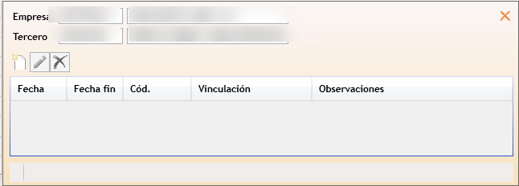

#   Terceros vinculados (Modelo 232)

**Terceros vinculados** es la ventana donde se define, para cada ejercicio, qué terceros están vinculados a cada empresa y con qué tipo de vinculación, de cara al Modelo 232. Se muestra como una **matriz**: una fila por tercero y una columna por empresa.

---

<aside class="doc-sidebar">
  
En esta página

  <ul>
    <li><a href="#cómo-se-abre">Cómo se abre</a></li>
    <li><a href="#ejercicio">Ejercicio</a></li>
    <li><a href="#la-matriz-de-vinculaciones">La matriz de vinculaciones</a></li>
    <li><a href="#añadir-un-tercero-a-la-matriz">Añadir un tercero a la matriz</a></li>
    <li><a href="#histórico-de-vinculación">Histórico de vinculación</a></li>
    <li><a href="#asociación-con-navision">Asociación con Navision</a></li>
    <li><a href="#tipos-de-vinculación">Tipos de vinculación</a></li>
    <li><a href="#avisos-habituales">Avisos habituales</a></li>
  </ul>
  
Relacionado

  <ul>
    <li><a href="MovVinculada232Window.html">Operaciones vinculadas</a></li>
    <li><a href="RelPerEntidVincAr164RisWindow.html">Personas/Entidades vinculadas Art. 16.4 RIS</a></li>
    <li><a href="RelModelo232Window.html">Lista de declaraciones del Modelo 232</a></li>
    <li><a href="Modelo232Window.html">Ficha de declaración del Modelo 232</a></li>
    <li><a href="../../../Modulos.html">Módulos</a></li>
    <li><a href="../../../UsoGeneral.html">Uso general</a></li>
  </ul>
</aside>

## Cómo se abre

Desde la ventana de [Operaciones vinculadas](MovVinculada232Window.html), pulsa el botón  **Terceros vinculados** de la cinta de opciones.

> Este botón solo aparece si tienes permiso de ejecución sobre esta ventana; no existe ningún otro punto de la aplicación desde el que se pueda abrir.

---

## Ejercicio

En la cabecera se indica el **Ejercicio** (año, 4 dígitos). La matriz muestra la situación de vinculación vigente entre el 1 de enero y el 31 de diciembre de ese año: solo aparecen los terceros y empresas que tuvieron alguna vinculación dentro de ese periodo.

---

## La matriz de vinculaciones

Se genera una columna por cada **empresa** GTA asociada a Navision, que tenga vinculaciones en el ejercicio, y una fila por cada **tercero** vinculado a alguna de ellas. La columna **Tercero** (con su nombre) es la única fija, situada siempre a la izquierda, y no es editable.

Cada celda del cruce tercero/empresa muestra el **tipo de vinculación vigente** entre ambos en el ejercicio, con un color distinto según el tipo:

- Si en la celda de una empresa consigo misma (la diagonal de la matriz), se muestra sombreada y sin texto: no existe vinculación de una empresa con ella misma.
- Si ha habido más de un tipo de vinculación dentro del mismo ejercicio (por ejemplo, un cambio de tipo a mitad de año), la celda muestra un asterisco (**\***).
- Al situar el cursor sobre una celda aparece  para ir directamente a la [asociación con Navision](#asociación-con-navision) de ese tercero y esa empresa.

Pulsa sobre el texto de la celda para abrir su [histórico de vinculación](#histórico-de-vinculación).

---

## Añadir un tercero a la matriz

1. Pulsa  **Nuevo** en la cinta de opciones.
2. Busca y selecciona el tercero (solo se pueden añadir terceros que tengan CIF informado).
3. El tercero se añade como nueva fila de la matriz, sin ninguna vinculación todavía.
4. Para asignarle un tipo de vinculación con una empresa, pulsa la celda del cruce correspondiente y añade un periodo en el [histórico de vinculación](#histórico-de-vinculación).

> Si el tercero ya está incluido en la matriz, la aplicación avisa: *"El tercero {código}-{nombre} ya está incluido en la matriz de vinculaciones"*, y sitúa el cursor en su fila existente en lugar de duplicarla.
>
> Esta ventana no tiene botón para eliminar un tercero completo de la matriz; para retirar una vinculación, elimina sus periodos desde el histórico de vinculación de cada celda.

---

## Histórico de vinculación

Al pulsar sobre el texto de una celda de la matriz se abre una ventana emergente con el **histórico de periodos de vinculación** entre ese tercero y esa empresa:

| Campo | Descripción |
| --- | --- |
| **Fecha inicio** | Inicio de vigencia del periodo. |
| **Fecha fin** | Fin de vigencia del periodo. |
| **Tipo de vinculación** | Código del tipo de vinculación. *Obligatorio.* Se selecciona mediante [buscador](../../../BusquedaValoresCampos.html). |
| **Vinculación** | Descripción del tipo de vinculación seleccionado. Solo lectura. |
| **Observaciones** | Texto libre. |

Puedes añadir, editar o eliminar periodos con los botones habituales de gestión de datos (ver [Uso general](../../../UsoGeneral.html#grupo-gestión-datos-de-la-cinta-de-opciones)).

> No se pueden guardar dos periodos de vinculación con fechas que se solapen para el mismo tercero y empresa. Si ocurre, la aplicación avisa: *"Las fechas se solapan con otro periodo de vinculación: {fecha} a {fecha}"*.
>
> Al eliminar un periodo no se comprueba si ya existen operaciones del Modelo 232 grabadas con esa clasificación de vinculación; ten cuidado al eliminar periodos de ejercicios ya declarados.

---

## Asociación con Navision

Antes de poder importar los movimientos de un tercero en [Operaciones vinculadas](MovVinculada232Window.html), es necesario asociarlo con su cliente o proveedor correspondiente en Navision. Al situar el cursor sobre una celda de la matriz (excepto en la diagonal), aparece un botón que abre esta asociación para ese tercero y esa empresa concretos.

| Campo | Descripción |
| --- | --- |
| **Empresa** | Empresa GTA (con conexión a Navision configurada). |
| **Tercero** | Tercero GTA a asociar. |
| **Mostrar no asociados** | Casilla que filtra la lista para mostrar solo los terceros que todavía no tienen ninguna asociación Navision. |
| **Tipo tercero Navision** | Cliente o Proveedor. |
| **Cód. tercero Navision** | Código del cliente o proveedor en Navision correspondiente. El buscador cambia según el tipo de tercero seleccionado. |
| **Nombre** / **Alias** | Datos del cliente/proveedor Navision, informativos. |

> Un mismo tercero puede tener varias asociaciones: por ejemplo, ser a la vez cliente y proveedor Navision, o tener varios códigos distintos.

Además de los botones habituales de gestión de datos, la cinta incluye:

- **Eliminar asociado** — quita la asociación de la fila seleccionada.
- **Asociar NIF** — ejecuta un proceso automático que intenta asociar los terceros mostrados (todos los pendientes, si está activada **Mostrar no asociados**, o solo el tercero activo en caso contrario) con su cliente o proveedor Navision a partir del NIF.

> Al pulsar cualquiera de los botones sin haber seleccionado antes una empresa o un tercero, la aplicación avisa: *"Selecciona una empresa antes de añadir una vinculación"* / *"Selecciona un tercero antes de añadir una asociación"*. Al buscar un código Navision sin haber indicado antes el tipo de tercero, avisa: *"Selecciona el tipo de tercero para empezar a buscar."*

---

## Avisos habituales

| Aviso | Causa |
| --- | --- |
| *"El tercero {código}-{nombre} ya está incluido en la matriz de vinculaciones"* | Se intentó añadir un tercero que ya existe como fila de la matriz. |
| *"Las fechas se solapan con otro periodo de vinculación: {fecha} a {fecha}"* | El periodo introducido en el histórico se solapa con otro ya existente para el mismo tercero y empresa. |
| *"El tipo de vinculación es obligatorio"* | Se intentó guardar un periodo de vinculación sin indicar el tipo. |
| *"La fecha de inicio {fecha} debe ser anterior o igual a la final {fecha}"* | La fecha de inicio del periodo es posterior a su fecha de fin. |
| *"Selecciona una empresa antes de añadir una vinculación"* | Se intentó gestionar la asociación con Navision sin haber seleccionado antes una empresa. |
| *"Selecciona un tercero antes de añadir una asociación"* | Se intentó gestionar la asociación con Navision sin haber seleccionado antes un tercero. |
| *"Selecciona el tipo de tercero para empezar a buscar."* | Se intentó buscar un código de cliente/proveedor Navision sin indicar antes si es cliente o proveedor. |
| *"Termina antes la edición del tipo de vinculación."* | Se intentó navegar a la asociación Navision con una edición del histórico de vinculación todavía sin confirmar. |

---

[Arriba](#top)
