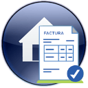

#   Periodos de facturación de un contrato

**Periodos de facturación** muestra, para un contrato inmobiliario, sus periodos de facturación previstos frente a los realmente facturados y cobrados, con las diferencias entre ambos.

---

<aside class="doc-sidebar">
  
En esta página

  <ul>
    <li><a href="#cómo-se-abre">Cómo se abre</a></li>
    <li><a href="#la-lista">La lista</a></li>
    <li><a href="#eliminar-un-periodo">Eliminar un periodo</a></li>
    <li><a href="#avisos-habituales">Avisos habituales</a></li>
  </ul>
  
Relacionado

  <ul>
    <li><a href="EntidadContratoWindow.html">Ficha de contrato inmobiliario</a></li>
    <li><a href="RelEntidadContratoWindow.html">Contratos inmobiliarios</a></li>
    <li><a href="EntidadContratoGenPerWindow.html">Generación de periodos</a></li>
    <li><a href="../../Modulos.html">Módulos</a></li>
    <li><a href="../../UsoGeneral.html">Uso general</a></li>
  </ul>
</aside>

## Cómo se abre

Desde la [ficha](EntidadContratoWindow.html) o la [lista](RelEntidadContratoWindow.html) de contratos inmobiliarios, botón **Periodos de facturación**.

> Esta ventana siempre muestra los periodos del **contrato padre**: si el contrato activo es una adenda, verás los periodos del contrato principal, no los de la adenda. Si ya tienes abierta esta ventana para el mismo contrato, se reutiliza en lugar de abrir una nueva.

Los periodos se crean desde la [ventana de generación de periodos](EntidadContratoGenPerWindow.html) de la ficha de contrato.

---

## La lista

| Columna | Descripción |
| --- | --- |
| **Periodo de facturación** | Número de periodo. |
| **Tipo de pago** | Tipo de pago del periodo. |
| **Fecha** | Fecha del periodo. |
| **Previsto: base / cuota IVA / IRPF / total** | Importes previstos según el plan de pagos del contrato. |
| **Real: base / cuota IVA / total factura / total a pagar** | Importes realmente facturados. |
| **Pendiente de cobro** / **Pendiente del periodo** | Importes todavía no cobrados. |
| **Diferencia base / total / total a pagar** | Diferencia entre lo previsto y lo real. |
| **Importe cobrado** | Importe ya cobrado del periodo. |
| **Observaciones** | Texto libre. |

> Los importes "reales" se recalculan automáticamente cada vez que abres o refrescas la ventana, cruzando las facturas asociadas al periodo.

La fila de totales suma los importes de todos los periodos del contrato.

---

## Eliminar un periodo

Selecciona uno o varios periodos y pulsa  **Eliminar**.

> No se pueden eliminar periodos que ya tengan facturación definitiva asociada (registrada en Navision). Si seleccionas varios y alguno no se puede eliminar, la aplicación te avisa y te ofrece eliminar el resto. Al eliminar un periodo se eliminan también sus facturas no registradas asociadas, si las hubiera.

---

## Avisos habituales

| Aviso | Causa |
| --- | --- |
| *"No se puede eliminar los periodos seleccionados por tener facturación definitiva asociada."* | Todos los periodos seleccionados tienen facturación definitiva. |
| *"No se pudo eliminar 1 periodo por tener facturación definitiva asociada" / "No se pudieron eliminar {n} periodos por tener facturación definitiva asociada."* | Parte de la selección no se puede eliminar. Se ofrece continuar con el resto. |
| *"Se eliminará el periodo de facturación seleccionado." / "Se eliminarán los {n} periodos seleccionados y sus facturas no registradas asociadas (si las hubiera)"* | Confirmación antes de eliminar. |

---

[Arriba](#top)
