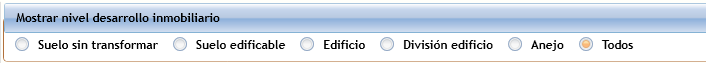

#   Lista de Entidades inmobiliarias

**Entidades inmobiliarias** muestra, en árbol y en rejilla, las unidades (viviendas, locales, plazas de garaje, trasteros, elementos de suelo...) que componen una promoción o un estudio de viabilidad. El detalle completo de cada entidad se gestiona en su [ficha](EntidadWindow.html).

---

<aside class="doc-sidebar">
  
En esta página

  <ul>
    <li><a href="#cómo-se-abre">Cómo se abre</a></li>
    <li><a href="#cabecera">Cabecera</a></li>
    <li><a href="#el-árbol-de-entidades">El árbol de entidades</a></li>
    <li><a href="#la-lista">La lista</a></li>
    <li><a href="#crear-una-entidad-nueva">Crear una entidad nueva</a></li>
    <li><a href="#abrir-una-entidad">Abrir una entidad</a></li>
    <li><a href="#eliminar-entidades">Eliminar entidades</a></li>
    <li><a href="#utilidades">Utilidades</a></li>
    <li><a href="#avisos-habituales">Avisos habituales</a></li>
  </ul>
  
Relacionado

  <ul>
    <li><a href="EntidadWindow.html">Ficha de entidad inmobiliaria</a></li>
    <li><a href="RelEntidadContratoWindow.html">Contratos inmobiliarios</a></li>
    <li><a href="RelFincaCatastralWindow.html">Fincas catastrales</a></li>
    <li><a href="RelFincaRegistralWindow.html">Fincas registrales</a></li>
    <li><a href="EntidadRptWindow.html">Informe de entidades</a></li>
    <li><a href="RelTipoEntidadWindow.html">Tipos de entidad</a></li>
    <li><a href="RelTipoEntidadComWindow.html">Tipos de entidad comercial</a></li>
    <li><a href="../../Modulos.html">Módulos</a></li>
    <li><a href="../../UsoGeneral.html">Uso general</a></li>
  </ul>
</aside>

## Cómo se abre

Desde la ventana principal, pestaña **Inmobiliario**, botón **Entidades**.

---

## Cabecera

| Campo | Descripción |
| --- | --- |
| **Empresa** | Empresa propietaria de las entidades. |
| **Referencia** | Promoción al que pertenecen las entidades mostradas. |

---

## El árbol de entidades

El panel izquierdo muestra el árbol jerárquico de las entidades de la promoción de manera que la promoción pueda representarse de una manera más visual. La jerarquía es propia de cada promoción y se establece manualmnete arrastrando y soltando los nodos. La jerarquía no determina de ninguna forma las entidades que pueden incluirse en un contrato de promoción. Es decir, en un contrato de promoción se puede incluir cualquier entidad, independientemente de su posición en el árbol. De igual forma, la inclusión de entidades en contrato de promoción no modifica el árbol.

La etiqueta **"Nodo activo"** indica el nodo seleccionado, cuya selección se sincroniza con la fila correspondiente de la rejilla.

> Es responsabilidad del usuario que la jerarquía del árbol de entidades guarde relación con los contratos inmobiliarios.

---

## La lista

| Columna | Descripción |
| --- | --- |
| **Entidad** | Código y descripción de la entidad. Identificación única dentro de la empresa. |
| **Identidad** | Identificiación de la entidad dentro de la promoción. |
| **Tipo de entidad** / **Tipo de entidad comercial** | Clasificación de la entidad, de los catálogos de [tipos de entidad](RelTipoEntidadWindow.html) y [tipos de entidad comercial](RelTipoEntidadComWindow.html). |
| **Comentario** | Texto libre. |
| **Dirección** | Sigla, vía, número, letra, bloque, escalera, planta, puerta, dato complementario, código postal, municipio y provincia. |
| **PVP vigente** | Precio de venta al público vigente. Pulsa para ver su histórico. |
| **Estado contrato activo** | Estado del contrato inmobiliario activo de la entidad, si lo tiene, resaltado en color; pulsa el icono para ir directamente a ese contrato. |
| **Orden DH** | Número de orden en la división horizontal. |
| **Registro / Finca** / **% finca registral** | Finca registral asociada y porcentaje que aporta a la entidad. Pulsa sobre la finca para ir a su ficha. |
| **Referencia catastral** / **% finca catastral** | Finca catastral asociada y porcentaje aportado. Pulsa para ir a su ficha. |
| **Dimensión Navision** | Código y valor de dimensión de Business Central, si la empresa está vinculada a Navision. |

> 
> Puedes filtrar la vista por **Nivel de desarrollo inmobiliario** ([tipo de entidad](RelTipoEntidadWindow.html) que representa suelo, edificio, división, anejo...) con los botones de opción de la cabecera, o mostrar todos los niveles a la vez.

---

## Crear una entidad nueva

Pulsa  **Nuevo** en la cinta de opciones. La nueva entidad hereda la localización jerárquica del nodo activo del árbol, y se abre su [ficha](EntidadWindow.html) en modo alta.

> Para crear una entidad necesitas permiso de alta, tener seleccionada una empresa, un nodo activo en el árbol, y que la empresa tenga configurada una serie de codificación de entidades. Si falta alguno de estos requisitos, la aplicación te lo indica antes de continuar.

---

## Abrir una entidad

Haz doble clic en una fila, o selecciónala y pulsa **Editar**, para abrir su [ficha completa](EntidadWindow.html).

---

## Eliminar entidades

Selecciona una o varias entidades y pulsa  **Eliminar**. Se solicita confirmación antes de proceder.

> No se puede eliminar una entidad que tenga contratos o anomalías asociadas; la aplicación te lo indica y no permite continuar con esas entidades.

---

## Utilidades

Desde la cinta de opciones también puedes:

- **Reconstruir árbol de entidades** — recalcula desde cero la jerarquía de nodos de la promoción o estudio.
- **Exportar a Excel** — exporta la lista, tal como se ve en pantalla, a un libro Excel titulado *"INFORME DE ENTIDADES INMOBILIARIAS"*.
-  **[Informe de entidades](EntidadRptWindow.html)** — genera un informe completo en Excel, con superficies, coeficientes y precios, y permite también importar datos desde él.

---

## Avisos habituales

| Aviso | Causa |
| --- | --- |
| *"Selecciona una empresa"* | No hay empresa seleccionada. |
| *"Selecciona un estudio para ver sus entidades" / "Selecciona una referencia para ver sus entidades"* | No se ha indicado el estudio o la referencia sobre la que se muestran las entidades. |
| *"El usuario no tiene permisos para crear entidades inmobiliarias."* | No tienes permiso de alta. |
| *"No se puede añadir una entidad inmobiliaria. Selecciona antes una empresa."* | Falta la empresa al crear una entidad. |
| *"No se puede añadir entidad, falta el nodo activo del árbol de entidades."* | No hay ningún nodo seleccionado en el árbol al crear una entidad. |
| *"No se puede añadir una entidad inmobiliaria. No existe serie para codificar las entidades en la empresa."* | Falta configurar la serie de numeración de entidades de la empresa. |
| *"No se puede añadir una entidad inmobiliaria. Falta código estudio." / "...Falta código referencia."* | Falta el estudio o la referencia de contexto. |
| *"La entidad {código} (identidad {identidad}) tiene anomalías asociadas." / "...tiene contratos asociados."* | Se intentó eliminar una entidad que no se puede borrar por tener datos asociados. |
| *"¿Confirmas la eliminación?"* | Confirmación antes de eliminar una o varias entidades. |

---

[Arriba](#top)
